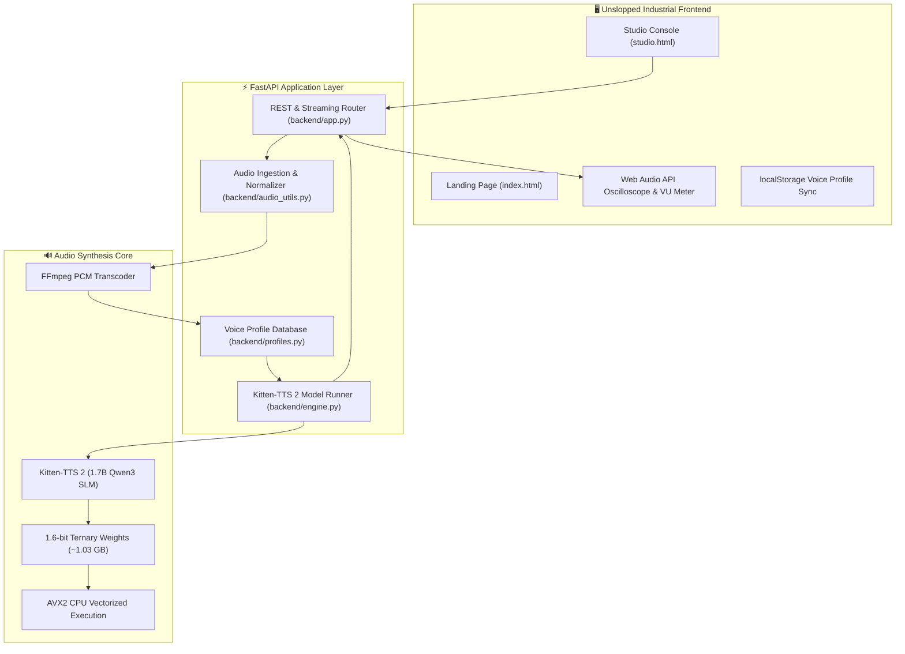
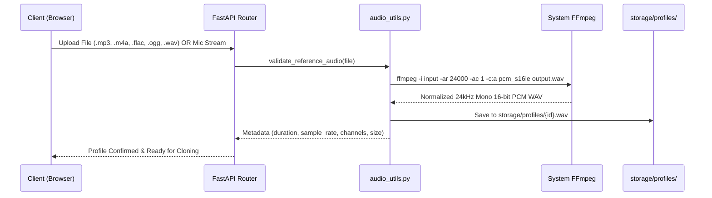

# Technical Architecture: Kitten-TTS 2 Studio

This document details the engineering specifications, memory constraints, model quantization, audio pipeline, and design choices behind **Kitten-TTS 2 Studio**.

---

## 1. High-Level System Architecture

---

## 2. Model & Compression Architecture

### 1.7B Speech Language Model
Kitten-TTS 2 is built upon a 1.7-billion-parameter speech language model utilizing a Qwen-based architecture with an integrated codec decoder. 

### 1.6-bit Exact Ternary Weight Quantization
To achieve real-time speech generation on consumer laptops without requiring dedicated graphics memory:
- **Ternary Compression**: Model weights are compressed into ternary values ({-1, 0, +1}), resulting in an average of **~1.6 bits per weight**.
- **Model Size on Disk**: The language model GGUF file is compressed to **~1.03 GB**.
- **Working Memory (RAM)**: The entire model executes within **~1.2 GB to 1.5 GB of RAM**.

### CPU-First Execution (AVX2 Vectorization)
Rather than saturating limited laptop VRAM (such as 2 GB GPUs where display compositors occupy >1.8 GB), Kitten-TTS 2 Studio runs natively on the **host CPU**. It utilizes AVX2 SIMD instructions to deliver 1.0x to 1.3x real-time generation speed.

---

## 3. Audio Ingestion & Normalization Pipeline

Zero-shot voice cloning fidelity heavily depends on the consistency of the reference audio input.

### Constraints Enforced:
1. **Sample Rate**: Exactly **24,000 Hz** (native rate of the Kitten-TTS 2 waveform decoder).
2. **Channel Format**: Single channel (**Mono**). Multi-channel audio is downmixed to prevent stereo phase cancellation.
3. **Encoding**: Signed 16-bit Little-Endian PCM (`pcm_s16le`).
4. **Duration Validation**: Recommends 5 to 30 seconds of clean speech. Clips under 3 seconds trigger warnings; clips over 60 seconds are clipped or warned.

---

## 4. UI/UX: The `/unslop` Hardware Aesthetic

The interface conforms to the `/unslop` design protocol created by Damir Sokolovsky:
- **Spatial Consistency**: A strict **4px layout grid** governs all elements (8px, 12px, 16px, 24px, 32px padding and gaps).
- **Color Discipline**: Built upon a neutral graphite ramp (`#0B0C0E` base, `#121419` surface, `#1F232D` borders) with a single studio-green accent (`#00E599`).
- **No Decorative Slop**: Zero purple gradients, no glowing blobs, no decorative emojis (16px line icons only).
- **One Bright Element**: The live oscilloscope canvas visualizer and real-time audio VU-meter.

---

## 5. Memory Footprint & Resource Budgeting (8 GB Envelope)

Tested under **Omarchy Linux** (Arch Rolling release) on an **Intel Core i5-8265U with 8 GB RAM**:

| Component | Working Set (RSS) | Allocation Strategy |
| :--- | :--- | :--- |
| **Linux OS + Hyprland** | ~1.8 GB | Base system memory |
| **FastAPI Web Server** | ~28 MB | Micro-footprint async event loop |
| **Kitten-TTS 2 Engine** | ~1.2 GB - 1.5 GB | Loaded lazily into CPU RAM on first synthesis |
| **Active Generation Peak** | ~1.6 GB | Intermediate audio tensors freed via `gc.collect()` |
| **Total Headroom Remaining** | **>4.0 GB Available** | Safely within physical memory limits |
