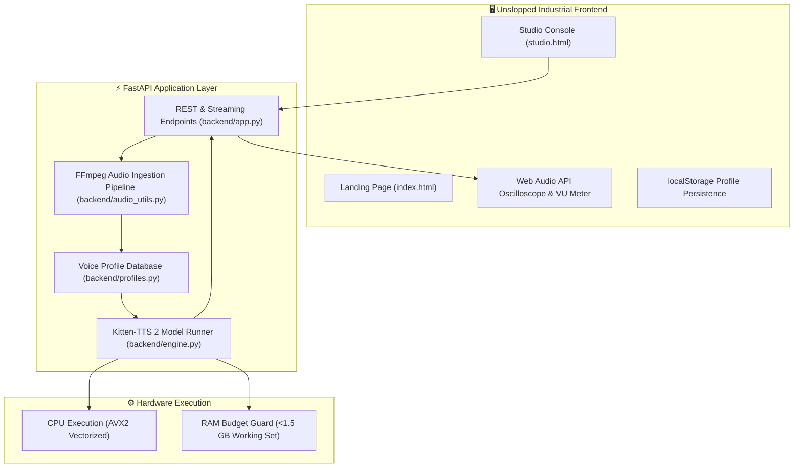

<div align="center">

# 🎙️ Kitten-TTS 2 Studio

**An industrial, unslopped local zero-shot voice cloning and speech synthesis console.**  
*Powered by Kitten-TTS 2 (1.7B Ternary SLM) • 100% Offline • CPU-Optimized for 8 GB Systems*

<br/>

<!-- ==================== BADGE MATRIX ==================== -->
[](https://python.org)
[](https://fastapi.tiangolo.com)
[](https://pytorch.org)
[-00E599?style=flat-square&color=00E599&labelColor=0E1116)](https://huggingface.co/KittenML/kitten-tts-2)
[]()
[]()
[](LICENSE)

[-00E599?style=flat-square&logo=google&logoColor=white)](https://deepmind.google)
[]()
[-success?style=flat-square&labelColor=0E1116)]()
[]()
[](https://heydamir.design/unslop)
[]()

[](https://github.com/SahooShuvranshu/KittenTTS-Studio/stargazers)
[](https://github.com/SahooShuvranshu/KittenTTS-Studio/network/members)
[](https://github.com/SahooShuvranshu/KittenTTS-Studio/issues)
[](CONTRIBUTING.md)
[](https://github.com/SahooShuvranshu/KittenTTS-Studio)

<br/>

[**Live Showcase & Interactive Demo**](https://sahooshuvranshu.github.io/KittenTTS-Studio) • [**Architecture Docs**](ARCHITECTURE.md) • [**Contributing Guide**](CONTRIBUTING.md)

</div>

---

## ⚡ Overview

**Kitten-TTS 2 Studio** is an open-source, local audio workstation created by [SahooShuvranshu](https://github.com/SahooShuvranshu) to clone human voices and synthesize expressive speech with zero cloud dependencies.

Built upon **KittenML/kitten-tts-2**—a 1.7-billion-parameter speech language model compressed using exact 1.6-bit ternary weights—this studio runs comfortably on standard laptop CPUs within a strict **8 GB physical RAM budget**, producing broadcast-ready 24,000 Hz audio.

---

## ✨ Key Highlights

- **Zero-Shot Voice Cloning**: Clone any voice in real time using a 5–30 second reference sample. No fine-tuning, training, or cloud upload required.
- **Dual Voice Ingestion**:
  - **Drag & Drop Upload**: Accepts `.wav`, `.mp3`, `.m4a`, `.flac`, and `.ogg`. Automatically normalized to 24 kHz mono 16-bit PCM WAV via FFmpeg.
  - **Live Browser Recording**: Capture reference samples directly from your microphone with real-time VU-level dynamics.
- **Voice Profile Registry & Memory**: Save, tag, and audition multiple voice identities. Selections persist automatically across browser reloads via `localStorage`.
- **Expression & Event Tags**: Control speech inflection with native tags:
  - Emotions: `[happy]`, `[whisper]`, `[serious]`, `[excited]`
  - Non-Speech Events: `<laugh>`, `<sigh>`
  - Stress & Prosody: `(((emphasis)))`
- **Unslopped Industrial Dashboard**: Built in adherence to the `/unslop` design protocol. Zero purple gradients, no glowing blobs, and no decorative emojis. Features a real-time oscilloscope canvas and a strict 4px layout grid.
- **100% Offline & Private**: Zero analytics, zero cloud transmission, zero telemetry.

---

## 🏗️ Technical Architecture



*For complete memory allocation profiles, codec specs, and benchmarks, see [ARCHITECTURE.md](ARCHITECTURE.md).*

---

## 🚀 Quickstart

### Prerequisites
- **OS**: Linux (Arch, Ubuntu, Debian, Fedora) or macOS.
- **Python**: 3.11 or 3.12 (Python 3.12 recommended).
- **FFmpeg**: Required for audio transcoding (`sudo pacman -S ffmpeg` or `sudo apt install ffmpeg`).
- **uv** (recommended) or `pip`.

### 1. Clone & Setup

```bash
git clone https://github.com/SahooShuvranshu/KittenTTS-Studio.git
cd KittenTTS-Studio

# Create virtual environment and install dependencies
uv venv .venv --python 3.12
source .venv/bin/activate
uv pip install -e .
```

### 2. Launch Local Studio

```bash
chmod +x run_studio.sh
./run_studio.sh
```

The studio starts at **`http://127.0.0.1:8765`** and opens automatically in your browser.

---

## 🌐 Remote & Cloud Deployment

Kitten-TTS 2 Studio is cloud-ready and can be hosted on a remote server, VPS, or private Tailscale mesh:

```bash
# Bind to all network interfaces with custom port
export HOST="0.0.0.0"
export PORT="8765"
export CORS_ORIGINS="*"

./run_studio.sh
```

Access the studio from any smartphone, laptop, or remote workstation over your network at `http://your-server-ip:8765`.

---

## 🎛️ Expression & Emotion Syntax Guide

Kitten-TTS 2 natively parses emotional markers and vocal inflections inline:

| Tag | Intonation Effect | Example Usage |
| :--- | :--- | :--- |
| `[happy]` | Warm, upbeat, energetic delivery | `[happy] Good morning! The system telemetry looks fantastic today.` |
| `[whisper]` | Quiet, intimate, breathy tone | `[whisper] Keep your voice down, the servers are sleeping.` |
| `[serious]` | Authoritative, firm, steady cadence | `[serious] Critical threshold reached. Initiating protocol zero.` |
| `[excited]` | Rapid tempo and elevated pitch | `[excited] We just benchmarked over 1.2x real-time generation on CPU!` |
| `<laugh>` | Audible laugh / chuckle event | `You really thought that would fail? <laugh> It compiled on the first try.` |
| `<sigh>` | Exhale / contemplative pause | `Another 3:00 AM debugging session. <sigh> Back to the terminal.` |
| `(((text)))` | Heavy pitch & volume emphasis | `This parameter is (((crucial))) for memory stability.` |

---

## 📡 REST API Reference

The backend provides a clean, self-documented REST API:

| Endpoint | Method | Payload | Description |
| :--- | :--- | :--- | :--- |
| `POST /api/synthesize` | JSON | `{ text, speed, profile_id }` | Synthesizes text; clones speaker if `profile_id` is passed. |
| `POST /api/upload-sample` | Multipart | Audio File | Normalizes upload to 24kHz mono WAV and returns metadata. |
| `POST /api/profiles/save-sample` | JSON | `{ filename, name }` | Persists temporary sample as permanent voice profile. |
| `POST /api/profiles/record` | Multipart | Mic Blob + Name | Saves in-browser recording directly into profile store. |
| `GET /api/profiles` | GET | None | Lists all saved voice profiles. |
| `PUT /api/profiles/{id}` | PUT | `{ name, description }` | Renames or updates notes on a profile. |
| `DELETE /api/profiles/{id}` | DELETE | None | Deletes voice profile and deletes reference WAV. |
| `GET /api/audio/{filename}` | GET | None | Streams audio with range-header support. |
| `GET /api/telemetry` | GET | None | Returns real-time host RAM, CPU load, and model status. |

---

## 📈 Star History

[](https://star-history.com/#SahooShuvranshu/KittenTTS-Studio&Date)

---

## 🤝 Contributing

Contributions are welcomed! Please read our [Contributing Guidelines](CONTRIBUTING.md) and [Code of Conduct](CODE_OF_CONDUCT.md) before opening pull requests.

---

## 📜 Credits & Acknowledgments

This project is made possible through the combined efforts of:

- **[SahooShuvranshu](https://github.com/SahooShuvranshu)**: Project Lead, System Architecture, & Open-Source Author.
- **[Google DeepMind Antigravity](https://deepmind.google)**: Autonomous AI Architect & Agentic Co-Engineer.
- **[KittenML Team](https://github.com/KittenML)**: Kitten-TTS 2 1.7B Speech Language Model and ternary quantization.
- **[Damir Sokolovsky](https://heydamir.design/unslop)**: Creator of the `/unslop` design protocol.

---

## 📄 License

Distributed under the **MIT License**. See [`LICENSE`](LICENSE) for complete terms.  
Copyright (c) 2026 SahooShuvranshu.
