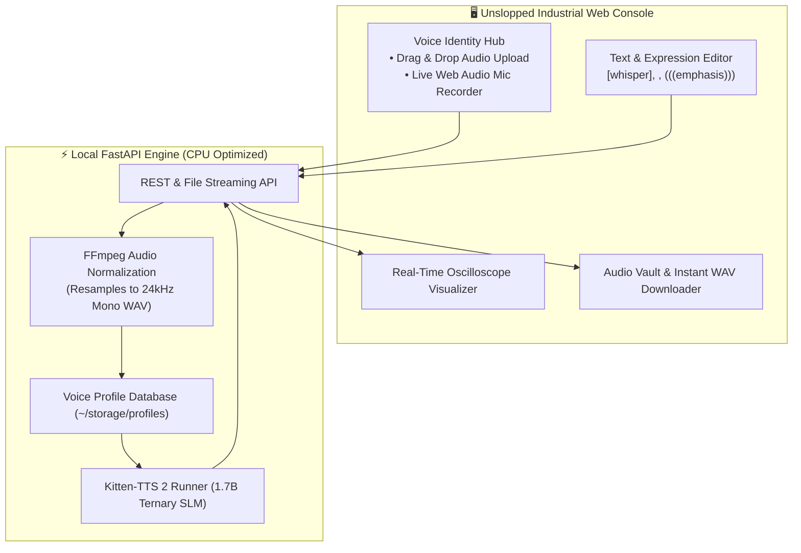

<div align="center">

# 🎙️ Kitten-TTS 2 Studio

**An industrial, unslopped local zero-shot voice cloning and speech synthesis console.**  
*Powered by Kitten-TTS 2 (1.7B Ternary SLM) • 100% Offline • CPU-Optimized for 8 GB Systems*

[](https://python.org)
[-00E599?style=flat-square&color=00E599&labelColor=0E1116)](https://huggingface.co/KittenML/kitten-tts-2)
[](LICENSE)
[]()
[]()

</div>

---

## ⚡ Overview

**Kitten-TTS 2 Studio** is an open-source, production-grade local audio workstation designed to clone human voices and synthesize expressive speech without relying on paid APIs or heavy cloud GPUs.

Built around **KittenML/kitten-tts-2**—a 1.7-billion-parameter speech language model compressed with 1-bit/ternary weights (~1.6 bits per weight)—this studio runs smoothly on standard laptop CPUs within a strict **8 GB RAM budget**, producing crisp 24 kHz broadcast-ready audio.

---

## ✨ Key Features

- **Zero-Shot Voice Cloning**: Clone any voice in real time using a 5–30 second reference sample. No fine-tuning or model retraining required.
- **Dual Voice Ingestion**:
  - **File Upload**: Drag and drop existing audio clips (`.wav`, `.mp3`, `.m4a`, `.flac`, `.ogg`). The studio automatically converts and normalizes them into clean 24 kHz mono WAV files.
  - **In-Browser Mic Capture**: Record live voice references directly in your browser with real-time VU-level metering.
- **Voice Profile Registry**: Save, tag, and organize multiple voice identities (e.g., *Natural*, *Podcast Host*, *Storyteller*) for instant switching.
- **Expression & Event Tags**: Control inflection with native emotion tags (`[happy]`, `[whisper]`, `[serious]`, `[excited]`), inline vocal events (`<laugh>`, `<sigh>`), and emphasis spans (`(((emphasis)))`).
- **Unslopped Industrial Dashboard**: Built in adherence to the `/unslop` design ethos. No purple gradients, no emoji labels, no neon glows. Clean obsidian surfaces, strict 4px grid spacing, tabular metrics, and a real-time audio oscilloscope visualizer.
- **Local & Private**: All audio processing and inference happen completely offline on your own machine.

---

## 🏗️ Architecture



---

## 🚀 Quickstart

### Prerequisites

- **OS**: Linux (Arch, Ubuntu, Debian, Fedora) or macOS.
- **Python**: 3.11 or 3.12 (Python 3.12 recommended).
- **FFmpeg**: Required for audio normalization (`sudo pacman -S ffmpeg` or `sudo apt install ffmpeg`).
- **uv** (recommended) or standard `pip`.

### 1. Clone & Setup

```bash
git clone https://github.com/your-username/KittenTTS-Studio.git
cd KittenTTS-Studio

# Create virtual environment and install dependencies
uv venv .venv --python 3.12
source .venv/bin/activate
uv pip install -r pyproject.toml
```

### 2. Launch Studio

Run the one-click startup script:

```bash
chmod +x run_studio.sh
./run_studio.sh
```

The studio will start at **`http://127.0.0.1:8765`** and automatically open in your default browser.

---

## 🎛️ Expression & Emotion Syntax

Kitten-TTS 2 natively understands inline emotional tags. Simply wrap your phrases or prepend emotions:

| Tag | Effect | Example |
| :--- | :--- | :--- |
| `[happy]` | Warm, cheerful delivery | `[happy] Welcome back! It is great to see you today.` |
| `[whisper]` | Quiet, intimate whispering | `[whisper] Keep this between us, okay?` |
| `[serious]` | Firm, authoritative tone | `[serious] System telemetry has reached nominal status.` |
| `[excited]` | High energy & rapid pacing | `[excited] We just launched the new version!` |
| `<laugh>` | Non-speech laugh event | `I never thought that would work! <laugh> But it did.` |
| `<sigh>` | Exhale / contemplative pause | `Here we go again. <sigh> Another night shift.` |
| `(((text)))` | Vocal emphasis / stress | `This is (((critical))) for system stability.` |

---

## 📡 API Reference

The backend exposes a lightweight REST API:

| Endpoint | Method | Description |
| :--- | :--- | :--- |
| `POST /api/synthesize` | JSON | Synthesizes text with optional reference voice and speed. |
| `POST /api/upload-sample` | Multipart | Uploads an audio clip, normalizes to 24kHz WAV, returns preview metadata. |
| `POST /api/profiles/save-sample` | JSON | Saves an uploaded sample as a permanent voice profile. |
| `POST /api/profiles/record` | Multipart | Saves in-browser mic recording as a voice profile. |
| `GET /api/profiles` | GET | Lists all saved voice profiles. |
| `DELETE /api/profiles/{id}` | DELETE | Deletes a voice profile. |
| `GET /api/history` | GET | Retrieves past generation logs with duration and timestamps. |
| `GET /api/audio/{filename}` | GET | Streams generated audio with range support. |
| `GET /api/telemetry` | GET | Returns real-time host RAM, CPU usage, and model status. |

---

## 💻 Hardware & Memory Footprint

Tested on an **Intel Core i5-8265U** with **8 GB RAM**:

- **Model Download**: ~1.03 GB (GGUF ternary weights cached automatically in Hugging Face cache).
- **RAM Working Set**: ~1.2 GB to 1.5 GB during active synthesis.
- **Latency**: Real-time to 1.2x real-time on 4-core mobile CPUs with AVX2.
- **VRAM Required**: 0 MB (runs purely on CPU to protect system stability).

---

## 📄 License

Distributed under the **MIT License**. See [`LICENSE`](LICENSE) for details.
Crafted with precision by [Shuvransu Sekhar Sahoo](https://github.com/shuvransusahoo) / Crystal Studio Labs.
